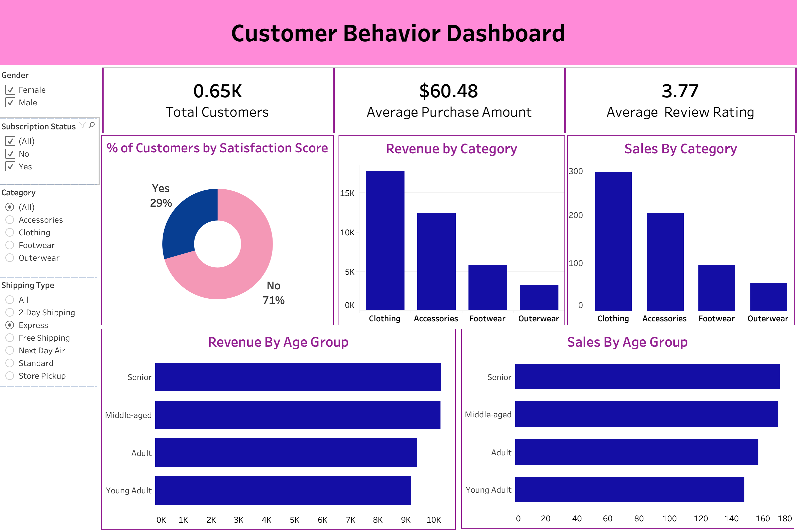

# Retail Customer Behavior & Revenue Analytics

An end-to-end data analytics project using **Python, PostgreSQL, and Tableau** to analyze customer spending, purchasing patterns, subscription adoption, and discount usage.

---

## 📌 Project Overview
Analyzed retail customer data to understand how demographics, shipping preferences, subscriptions, and discounts relate to purchasing behavior. Built an end-to-end pipeline covering data cleaning, SQL analysis, and interactive dashboard development to identify actionable business insights.

## 🛠️ Tech Stack
* **Python & Pandas:** Data cleaning, missing-value treatment, and feature engineering.
* **PostgreSQL & SQL:** Customer segmentation, aggregations, CTEs, subqueries, and window functions.
* **SQLAlchemy:** Python–PostgreSQL connectivity.
* **Tableau:** Interactive dashboard development and dynamic filtering.
* **Jupyter Notebook:** Data analysis and documentation.

## 🔄 Project Workflow
1. **Data Preparation:** Standardized column names, handled missing review ratings using category-specific medians, transformed purchase-frequency categories, and created age-based customer segments.
2. **SQL Analysis:** Analyzed spending patterns, subscription adoption, shipping preferences, and discount usage using advanced SQL techniques.
3. **Dashboard Development:** Built an interactive Tableau dashboard with KPI summaries, calculated fields, and dynamic filters.

## 📈 Key Findings
* **Shipping Preferences:** Express-shipping customers showed higher average purchase amounts, highlighting a relationship worth investigating further.
* **Subscription Adoption:** Some frequent buyers remained unsubscribed, presenting an opportunity to investigate subscription conversion.
* **Demographics:** Younger customer segments contributed a larger share of purchasing activity and revenue.
* **Discount Usage:** Outerwear and Hats showed substantial discount usage, warranting further investigation into pricing and promotional strategies.

## 📊 Dashboard Preview


🔗 **[Explore the Interactive Dashboard](ADD_TABLEAU_PUBLIC_URL)**

## 📁 Repository Structure
```text
customer_behavior_analysis/
│
├── dashboard/
│   ├── customer_behavior_dashboard.twbx
│   └── dashboard.png
│
├── data/
│   └── customer_shopping_behavior.csv
│
├── python_scripts/
│   └── Customer_Shopping_Behaviour_Analysis.ipynb
│
├── sql_queries/
│   └── customer_behavior_analysis.sql
│
└── README.md
```

## 💼 Business Value
The analysis identifies customer segments and purchasing patterns that can inform retention strategies, subscription adoption, and merchandising decisions. The project demonstrates an end-to-end workflow connecting data preparation, SQL analysis, and business intelligence visualization.
